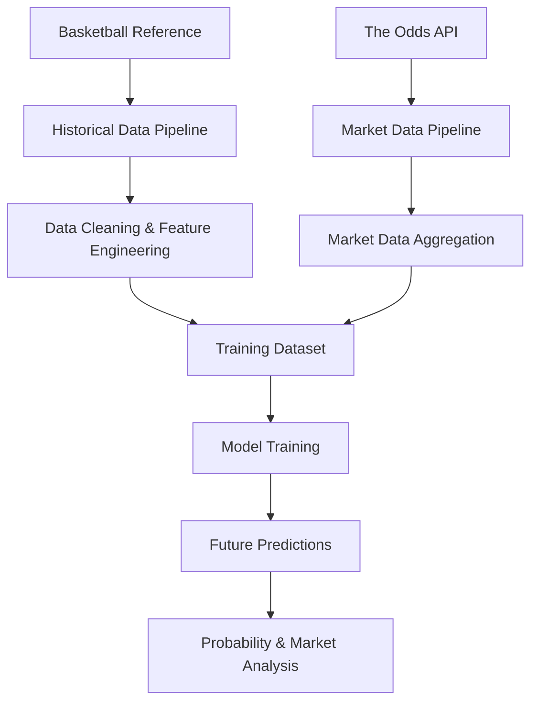

# NBA Predictive Analytics & Market Intelligence

**An NBA analytics pipeline for team scoring predictions, historical performance analysis, and sports betting market research.**

This project combines historical NBA game statistics with sportsbook odds data to build predictive features, train statistical models, and estimate game outcome probabilities.

**Status:** Independent research project · Research prototype

---

## Overview

The project brings together historical game data and sportsbook market information in a multi-stage analytics pipeline.

Its main stages include:

- Historical NBA statistics collection and preprocessing.
- Sportsbook odds collection and market data aggregation.
- Team-level feature engineering and performance analysis.
- Statistical modeling and machine learning.
- Future game predictions and probability estimation.
- Comparison of model estimates with sportsbook market lines.

## Architecture

## Repository Structure

The project is organized into four main Jupyter notebooks:

| Notebook | Description |
|---|---|
| `data_pipeline.ipynb` | Historical NBA data collection, preprocessing, and feature engineering |
| `market_pipeline.ipynb` | Sportsbook odds collection, market snapshots, and aggregation |
| `train_model.ipynb` | Model training, feature processing, and historical evaluation |
| `predict_future.ipynb` | Predictions for upcoming games and probability estimation |

## Technical Implementation

### Data Engineering

- Historical data extraction and incremental updates.
- Data cleaning and normalization.
- Team and game identification.
- Collection and aggregation of sportsbook market snapshots.
- CSV and Parquet data processing.

### Feature Engineering

The pipeline builds team-level features to describe recent performance, scoring patterns, and game conditions.

Key feature groups include:

- Rolling team performance metrics.
- Offensive and defensive indicators.
- Pace and scoring efficiency metrics.
- Rest days and back-to-back indicators.
- Performance volatility.
- Market-derived features.

### Predictive Modeling

The project explores several statistical and machine learning approaches:

- **XGBoost** — predicts team scoring using engineered features.
- **Ridge Regression** — provides regularized regression estimates.
- **PCA** — reduces feature dimensionality and helps analyze relationships between variables.
- **Student's t-distribution** — models prediction uncertainty for probability estimation.

### Evaluation & Market Analysis

- Walk-forward validation using historical game data.
- Historical prediction performance analysis.
- Over/Under probability estimation.
- Expected value calculations.
- Comparison of model estimates against sportsbook market lines.

## Technology Stack

| Category | Technologies |
|---|---|
| Language | Python |
| Data Processing | Pandas, NumPy |
| Machine Learning | Scikit-learn, XGBoost |
| Statistical Analysis | SciPy |
| Data Collection | BeautifulSoup, Cloudscraper |
| Environment | Jupyter Notebook |
| Storage | CSV, Parquet |

## Data Sources

- [Basketball Reference](https://www.basketball-reference.com/) — historical NBA statistics.
- [The Odds API](https://the-odds-api.com/) — sportsbook odds and market data.

Raw datasets, trained model artifacts, and API credentials are not included in the repository.

## Limitations

This repository is an independent research prototype. Model outputs and expected value estimates are based on historical data and do not guarantee predictive accuracy or profitable betting outcomes.

Reproducing the full pipeline requires access to the original data sources and the corresponding API credentials.

---

*An independent project exploring sports analytics, predictive modeling, and betting market data.*