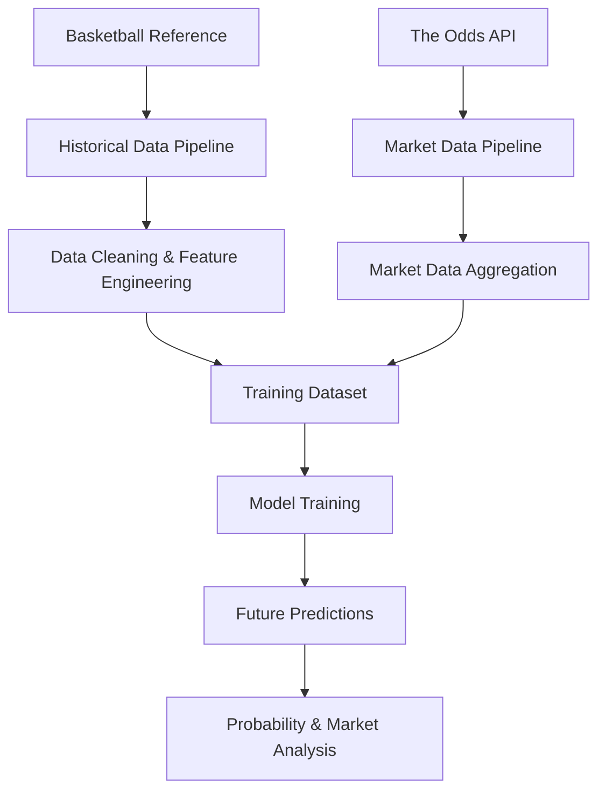

# NBA Predictive Analytics & Market Intelligence

**End-to-end NBA analytics pipeline for team scoring prediction, historical performance analysis, and sports betting market research.**

This project combines historical NBA statistics with sportsbook market data to build predictive features, train statistical models, and estimate game outcome probabilities.

**Status:** Independent research project · Research prototype

---

## Project Overview

The project implements a multi-stage analytics pipeline:

- Collection and processing of historical NBA game statistics
- Collection and aggregation of sportsbook market data
- Team-level feature engineering and historical performance analysis
- Predictive modeling using machine learning and statistical methods
- Future game predictions and probability estimation

## Architecture

## Repository Structure

| Notebook | Description |
|---|---|
| `data_pipeline.ipynb` | Historical NBA data collection, preprocessing, and feature engineering |
| `market_pipeline.ipynb` | Sportsbook odds collection, snapshots, and market aggregation |
| `train_model.ipynb` | Model training, feature processing, and historical evaluation |
| `predict_future.ipynb` | Predictions for upcoming games and probability estimation |

## Technical Implementation

### Data Engineering

- Historical data extraction and incremental updates
- Data cleaning and normalization
- Team and game identification
- Market snapshots collection and aggregation
- CSV and Parquet-based data processing

### Feature Engineering

- Rolling team performance metrics
- Offensive and defensive indicators
- Pace and scoring efficiency metrics
- Rest days and back-to-back indicators
- Performance volatility
- Market-derived features

### Predictive Modeling

The project explores several modeling approaches:

- **XGBoost** — machine learning-based scoring predictions
- **PCA** — dimensionality reduction and feature extraction
- **Ridge Regression** — regularized statistical modeling
- **Student's t-distribution** — probability estimation based on prediction uncertainty

### Evaluation & Market Analysis

- Walk-forward validation
- Historical prediction analysis
- Over/Under probability estimation
- Expected value calculations
- Comparison of model estimates with sportsbook market lines

## Technology Stack

| Category | Technologies |
|---|---|
| Language | Python |
| Data Processing | Pandas, NumPy |
| Machine Learning | Scikit-learn, XGBoost |
| Statistical Analysis | SciPy |
| Data Collection | BeautifulSoup, Cloudscraper |
| Environment | Jupyter Notebook |
| Storage | CSV, Parquet |

## Data Sources

- [Basketball Reference](https://www.basketball-reference.com/) — historical NBA statistics
- [The Odds API](https://the-odds-api.com/) — sportsbook market data and odds

Raw datasets, model artifacts, and API credentials are not included in the repository.

## Limitations

This repository represents an independent research prototype. Model predictions, historical performance, and expected value estimates do not establish guaranteed profitability or future betting returns.

Reproducing the complete pipeline requires access to the original data sources and the corresponding API credentials.

---

*Built as an independent data analytics and predictive modeling project.*